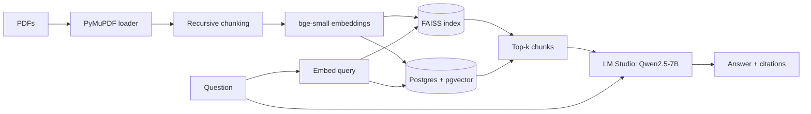

# Production Level RAG

A modular, open-source Retrieval-Augmented Generation (RAG) system that answers questions over PDF documents with page-level citations. Everything runs locally except the optional Supabase database: embeddings are computed on your GPU, the LLM is served by LM Studio, and the pipeline is evaluated with RAGAS.

> **Test corpus:** *The Adventures of Tom Sawyer* (public domain), about 900 chunks at the default settings.

## Features

- **PDF ingestion** with PyMuPDF; page number and filename are kept on every chunk for citations.
- **Recursive chunking** (paragraph, line, sentence, word) with configurable size and overlap.
- **Open-source embeddings:** `BAAI/bge-small-en-v1.5` via sentence-transformers (GPU if available), with normalized vectors and the bge query prefix.
- **Two interchangeable vector stores** behind the same `.retrieve()` interface:
  - FAISS (`IndexFlatIP`) for local, offline use
  - PostgreSQL + pgvector on Supabase (HNSW index, cosine distance)
- **Local LLM generation:** Qwen2.5-7B-Instruct (Q4_K_M GGUF) through LM Studio's OpenAI-compatible API, with a grounded prompt that answers only from retrieved context and says "I don't know" otherwise.
- **Evaluation with RAGAS:** context precision, context recall and faithfulness, using the local LLM as judge.
- **Streamlit web app** on top of the pgvector backend.

## Architecture



## Tech stack

| Layer | Tool |
|---|---|
| PDF parsing | PyMuPDF |
| Chunking | LangChain text splitters |
| Embeddings | sentence-transformers, `BAAI/bge-small-en-v1.5` (384-dim) |
| Vector search | FAISS, pgvector (Supabase) |
| LLM | Qwen2.5-7B-Instruct via LM Studio |
| Evaluation | RAGAS |
| UI | Streamlit |

## Project structure

```
.
├── config.py            # all settings in one place
├── chunking.py          # load PDFs, recursive chunking
├── embeddings.py        # embedding model, FAISS build/save/load
├── retrieval.py         # FaissRetriever
├── generation.py        # prompt + LLM call (LM Studio)
├── rag_pipeline.py      # CLI: build / ask / chat
├── evaluate_ragas.py    # RAGAS evaluation
├── eval_set.json        # question + reference answer pairs
├── pgvector_store.py    # Postgres/pgvector ingest + PgRetriever
├── supabase_setup.sql   # schema for the Supabase SQL Editor
├── app.py               # Streamlit app
├── GUIDE.md             # detailed walkthrough of every step
└── .env.example
```

## Quick start

### 1. Install

```bash
python -m venv venv
venv\Scripts\activate          # Windows  (Linux/macOS: source venv/bin/activate)
# For GPU embeddings, install the CUDA build of PyTorch first (pytorch.org)
pip install -r requirements.txt
```

If RAGAS fails to import with a `langchain_community ... vertexai` error, align the langchain versions:

```bash
pip install "ragas==0.3.9" "langchain-community<0.4" "langchain-openai<1" "langchain-core<1" "langchain<1"
```

### 2. Configure

```bash
cp .env.example .env
```

```
LLM_BASE_URL=http://localhost:1234/v1
LLM_API_KEY=lm-studio
LLM_MODEL=qwen2.5-7b-instruct
DATABASE_URL=postgresql://postgres.<project-ref>:<db-password>@aws-0-<region>.pooler.supabase.com:5432/postgres
```

`DATABASE_URL` is only needed for the pgvector backend. Use the **Session pooler** string from Supabase (Connect button) and a password without special characters.

### 3. Start the LLM

In LM Studio: download `Qwen2.5-7B-Instruct-GGUF` (Q4_K_M), load it with GPU offload set to max and context length 4096, then start the server from the Developer tab.

### 4. Run

Put PDFs in `data/`, then:

```bash
python rag_pipeline.py build                      # chunk + embed + save FAISS index
python rag_pipeline.py ask "Who is Tom's aunt?"   # one-shot question
python rag_pipeline.py chat                       # interactive
```

## Using pgvector on Supabase

1. Create a Supabase project and set `DATABASE_URL` in `.env`.
2. Optionally run `supabase_setup.sql` in the Supabase SQL Editor (the ingest script also creates the table).
3. Ingest once (re-running inserts duplicates; run `truncate table chunks;` first if needed):
   ```bash
   python pgvector_store.py ingest
   ```
4. Launch the app:
   ```bash
   streamlit run app.py
   ```

## Evaluation

Add question and reference-answer pairs to `eval_set.json`, then run:

```bash
python evaluate_ragas.py
```

Per-question scores are written to `ragas_results.csv`.

| Metric | Question it answers | Low score suggests |
|---|---|---|
| Context precision | Are useful chunks ranked near the top? | Reduce `TOP_K`, add a reranker |
| Context recall | Did retrieval fetch what the answer needs? | Larger chunks or `TOP_K`, hybrid search |
| Faithfulness | Is the answer supported by the retrieved chunks? | Tighten the prompt, use a larger model |

**Baseline (5-question set, `CHUNK_SIZE=500`, `CHUNK_OVERLAP=50`, `TOP_K=4`):** context precision 0.50, context recall 0.60, faithfulness 0.72. These come from a very small set with a 7B local judge, so they are useful for comparing configurations, not as absolute scores.

| Configuration | Precision | Recall | Faithfulness |
|---|---|---|---|
| 500 / 50 / top-4 (baseline) | 0.50 | 0.60 | 0.72 |
| *add your experiments here* | | | |

## Key settings (`config.py`)

| Setting | Default | Effect |
|---|---|---|
| `CHUNK_SIZE` / `CHUNK_OVERLAP` | 500 / 50 | Chunk length and shared text between neighbours |
| `TOP_K` | 4 | Chunks passed to the LLM |
| `EMBED_MODEL` / `EMBED_DIM` | bge-small / 384 | Changing the model means updating the Postgres `vector(...)` size and re-ingesting |

After changing chunking or the embedding model, rebuild the FAISS index and re-ingest into Postgres so both stores stay in sync.
